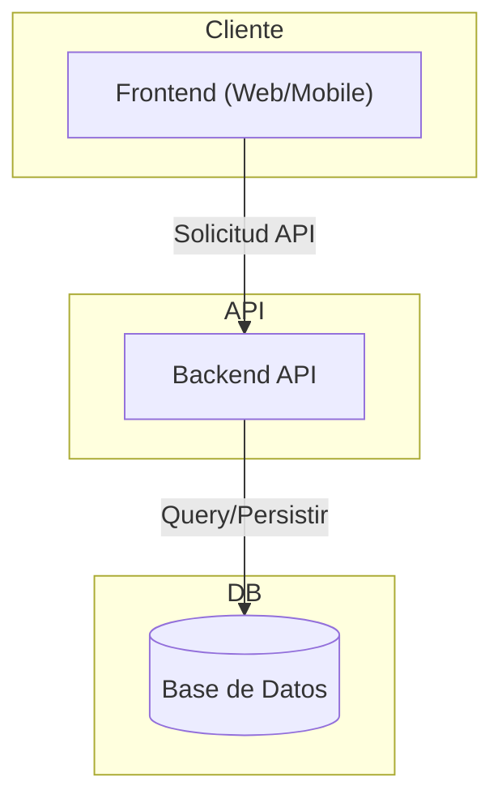
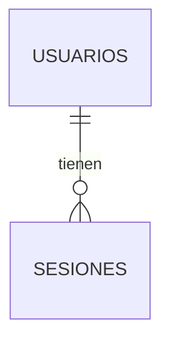

# Alfred — Asistente de Estructuración, Protocolo Documental y Puente con Jarvis

Este skill actúa como el mayordomo y asistente técnico del proyecto. Su misión es triple:
1. **Sincronizar** bidireccionalmente el contexto del proyecto con **Jarvis** (`/Users/davidrosello/Projects/Jarvis`).
2. **Inicializar** una estructura de documentación ("Vault") limpia, modular y de bajo consumo de contexto en proyectos nuevos que carezcan de ella.
3. **Mantener** la integridad de esta documentación a lo largo del ciclo de vida de cada feature, coordinándose con Git, Linear y los procesos de planificación (`grill-me` y `geoffrey`).

---

## Paso 0 — Sincronización con Segundo Cerebro (Jarvis) e Inicialización

### 0.A — Sincronización Bidireccional con Jarvis (Al iniciar sesión en un proyecto)
*(Ejecutar una sola vez al abrir sesión o iniciar una feature en cualquier proyecto distinto del propio Jarvis, no en cada turno).*

Verifica si existe una ficha para el proyecto actual dentro de `/Users/davidrosello/Projects/Jarvis/entities/projects/` (buscando por nombre del directorio o `repo_name` en `/Users/davidrosello/Projects/Jarvis/entities/ENTITY_INDEX.md`):

1. **Actualizar Jarvis antes de leer:** Ejecuta `/Users/davidrosello/Projects/Jarvis/scripts/auto-sync-jarvis.sh` (o `git -C /Users/davidrosello/Projects/Jarvis pull --ff-only`) para traer los últimos cierres diarios de Instinct.
2. **Absorber la `📥 Bandeja para docs/`:** Si la ficha `/Users/davidrosello/Projects/Jarvis/entities/projects/<slug>.md` tiene ítems pendientes (`- [ ] ...`) bajo la sección `## 📥 Bandeja para docs/`:
   - Inyéctalos en el `docs/BACKLOG.md` local del proyecto en el que estás trabajando (bajo `## Prioridad Alta` o `## Prioridad Media`, indicando `_(desde Segundo Cerebro)_`) y sincroniza en **Linear** si aplica.
   - Vacía la sección `## 📥 Bandeja para docs/` en `/Users/davidrosello/Projects/Jarvis/entities/projects/<slug>.md` (dejándola en `_(Vacía)_`), actualiza `## 📊 Resumen Sincronizado del Proyecto` con el estado actual de `docs/ROADMAP.md`, y haz `git commit` + `git push` en `/Users/davidrosello/Projects/Jarvis` para que Instinct vea la bandeja limpia y el estado actualizado en sus próximos Briefings.

---

### 0.B — Inicialización de `docs/` (Solo si no existe `docs/`)

Al iniciar sesión en un proyecto, verifica si existe la carpeta `docs/` en la raíz del espacio de trabajo.

Si **no existe**, debes crearla e inicializar la siguiente estructura de archivos "boilerplate" con su frontmatter YAML canónico (9 campos):

#### 1. `docs/INDEX.md` (Mapa del Vault y Estado Vivo)
```markdown
---
id: index
title: "Índice de Documentación y Estado Vivo"
category: meta
layer: context
role_context: "Cualquier rol / Agente IA"
tags: [index, mapa, navegacion, estado-vivo]
related: []
last_updated: "YYYY-MM-DD"
ai_directives:
- "Lee SIEMPRE primero este archivo al abrir una conversación nueva. No cargues otros .md salvo que la tarea dependa de ellos."
---

# Índice de Documentación del Proyecto

Bienvenido al vault de documentación. Este documento sirve de mapa y resumen ejecutivo del estado actual del proyecto.

## Estado Vivo (Contexto Rápido para Agentes)
- **Sprint / Foco Actual:** [Definir objetivo vigente]
- **Últimas 5 tareas cerradas:**
  - *(Ninguna todavía)*
- **Decisiones de arquitectura vigentes:**
  - *(Pendiente de inicializar)*
- **Bloqueos o alertas activas:**
  - *(Ninguno)*

## Estructura del Vault

- [[ROADMAP]] — Estado actual del sprint y metas del proyecto.
- [[BACKLOG]] — Listado priorizado de tareas y features pendientes.
- [[USER_STORIES]] — Historias de usuario y requerimientos de producto.
- [[CHANGELOG]] — Historial de cambios y releases por versión.
- [[ARCHITECTURE]] — Decisiones técnicas, esquemas de bases de datos e infraestructura.
- [[FACTS]] — Verdades innegociables, tarifas exactas, métricas reales y afirmaciones prohibidas (Anti-Alucinaciones).
- [[PLAYBOOKS]] — Playbooks operativos (comercial, editorial, growth) y registro del bucle de aprendizaje semanal.
- [[LESSONS]] — Aprendizajes, preferencias del cliente y reglas de prevención de errores técnicos.
```

#### 2. `docs/ROADMAP.md` (Hoja de Ruta del Proyecto)
```markdown
---
id: roadmap
title: "Roadmap del Proyecto"
category: product
layer: strategy
role_context: "Product Owner / Developer"
tags: [roadmap, sprints, planificacion]
related:
- "[[INDEX]]"
- "[[BACKLOG]]"
last_updated: "YYYY-MM-DD"
ai_directives:
- "Mantén este documento actualizado marcando las tareas del sprint actual como completadas."
---

# Roadmap del Proyecto

## Sprint Actual
- [ ] Feature 1
- [ ] Feature 2

## Siguientes Hitos (Q1/Q2)
- [ ] Hito A
- [ ] Hito B
```

#### 3. `docs/BACKLOG.md` (Listado de Tareas Pendientes)
```markdown
---
id: backlog
title: "Backlog del Proyecto"
category: product
layer: strategy
role_context: "Product Owner / Developer"
tags: [backlog, tareas, backlog-items]
related:
- "[[ROADMAP]]"
last_updated: "YYYY-MM-DD"
ai_directives:
- "Prioriza las tareas y añade nuevos requerimientos técnicos o de negocio aquí."
---

# Backlog de Desarrollo

## Prioridad Alta
- [ ] Tarea prioritaria 1

## Prioridad Media
- [ ] Tarea 2

## Ideas / Icebox
- [ ] Idea 1
```

#### 4. `docs/USER_STORIES.md` (Casos de Uso e Historias de Usuario)
```markdown
---
id: user-stories
title: "Historias de Usuario y Requerimientos"
category: product
layer: requirements
role_context: "Product Owner / Developer"
tags: [user-stories, requerimientos, UX]
related:
- "[[ROADMAP]]"
last_updated: "YYYY-MM-DD"
ai_directives:
- "Documenta las especificaciones funcionales detalladas de cada feature de usuario aquí."
---

# Historias de Usuario

## US-01: Nombre de la Historia de Usuario
- **Como** [Usuario]
- **Quiero** [Acción]
- **Para** [Beneficio]

### Criterios de Aceptación
- [ ] Criterio 1
- [ ] Criterio 2
```

#### 5. `docs/CHANGELOG.md` (Historial de Cambios)
```markdown
---
id: changelog
title: "Historial de Cambios (Changelog)"
category: devops
layer: infrastructure
role_context: "Developer / DevOps"
tags: [changelog, releases, versiones]
related:
- "[[INDEX]]"
last_updated: "YYYY-MM-DD"
ai_directives:
- "Registra aquí cada release relevante del software."
---

# Historial de Cambios

## [Unreleased]

### Añadido
- Inicialización del proyecto y estructura documental básica.
```

#### 6. `docs/ARCHITECTURE.md` (Documentación Técnica)
```markdown
---
id: architecture
title: "Arquitectura Técnica del Proyecto"
category: engineering
layer: architecture
role_context: "Tech Lead / Developer"
tags: [architecture, tech-stack, backend, frontend]
related:
- "[[INDEX]]"
last_updated: "YYYY-MM-DD"
ai_directives:
- "Actualiza este documento si cambia el stack tecnológico, base de datos o lógica clave."
---

# Arquitectura Técnica

## Stack Tecnológico
- **Frontend**: [Especificar, ej. React / Next.js / HTML & JS]
- **Backend/Base de Datos**: [Especificar, ej. Node.js / PostgreSQL / Supabase]

## Flujos de Datos Core
(Describir el flujo principal utilizando un diagrama de flujo de Mermaid y un breve texto explicativo. Consulta el skill `mermaid` para la sintaxis y diseño).



## Arquitectura de Datos / Entidades
(Describir el modelo de datos principal mediante un diagrama de entidad-relación (ERD) en Mermaid).


```

#### 7. `docs/FACTS.md` (Verdades y Cifras Innegociables — Anti-Alucinaciones)
```markdown
---
id: facts
title: "Verdades y Cifras Innegociables del Proyecto (SSoT Anti-Alucinaciones)"
category: business
layer: strategy
role_context: "Cualquier rol / Agente IA / Copywriter / Sales / Marketing"
tags: [facts, ssot, verdad, precios, metricas, guardrails]
related:
- "[[INDEX]]"
- "[[PLAYBOOKS]]"
last_updated: "YYYY-MM-DD"
ai_directives:
- "LECTURA OBLIGATORIA antes de redactar cualquier copy público, email comercial, artículo de blog, propuesta o pitch."
- "PROHIBIDO inventar tarifas, métricas, clientes, integraciones o funcionalidades que no figuren explícitamente aquí."
---

# Verdades y Cifras Innegociables (FACTS)

## 1. Identidad y URLs Canónicas
- **Nombre oficial**: [Nombre exacto y capitalización]
- **URL de producción**: [Dominio canónico]

## 2. Tarifas, Planes y Condiciones Comerciales Vigentes
- **Plan A**: [Precio exacto, periodo de prueba, qué incluye]
- **Límites comerciales**: [Qué NO se cobra, comisiones, permanencia]

## 3. Métricas Reales y Tracción Verificada
- **Usuarios / Clientes activos**: [Cifra verificada y fecha]
- **Hitos y reconocimientos reales**: [Premios, aceleradoras, pilotos reales]
- **Métricas financieras clave**: [OpEx, Break-Even, Runway si aplica]

## 4. Capacidades en Producción vs. No Existentes
- **En producción hoy**: [Lista de features reales]
- **En desarrollo / No prometer como activo**: [Features futuras que ningún agente debe vender como actuales]

## 5. Afirmaciones Prohibidas (Guardrails para Agentes)
- **Nunca afirmar**: [Ej. planes inexistentes, falsos testimonios, jerga interna prohibida]
```

#### 8. `docs/PLAYBOOKS.md` (Playbooks Operativos y Aprendizaje Semanal — The Loop)
```markdown
---
id: playbooks
title: "Playbooks Operativos y Bucle de Aprendizaje Semanal"
category: business
layer: strategy
role_context: "Growth / Sales / Marketing / Orquestador de Agentes"
tags: [playbooks, growth, outreach, editorial, loop, aprendizaje]
related:
- "[[INDEX]]"
- "[[FACTS]]"
last_updated: "YYYY-MM-DD"
ai_directives:
- "Consulta este documento antes de ejecutar campañas de outreach, generación editorial o flujos operativos."
- "Actualiza la sección de Aprendizajes Semanales (Friday Loop) únicamente con base en métricas reales verificadas y con aprobación humana del diff."
---

# Playbooks Operativos y Bucle de Aprendizaje

## 1. Playbook Comercial / Outreach Activo
- **Enfoques vigentes y reglas de asignación**: [Definición de ángulos, cadencias y criterios de scoring]
- **Qué funciona (validado con datos)**: [Patrones ganadores]
- **Qué evitar (descartado por datos)**: [Ángulos o asuntos con baja conversión]

## 2. Playbook Editorial / Contenido Activo
- **Estructura y ángulos ganadores**: [Reglas de SEO/GEO, tono y distribución]

## 3. Registro del Bucle de los Viernes (Friday Loop — Diffs Semanales)
- `YYYY-MM-DD`: [Métricas de la semana → Hipótesis → Ajuste aplicado al playbook tras aprobación humana]
```

#### 9. `docs/LESSONS.md` (Aprendizajes Técnicos y Reglas por Proyecto/Cliente)
```markdown
---
id: lessons
title: "Aprendizajes Técnicos y Reglas Operativas"
category: meta
layer: context
role_context: "Cualquier rol / Agente IA"
tags: [lessons, reglas, cliente, errores-evitados]
related:
- "[[INDEX]]"
last_updated: "YYYY-MM-DD"
ai_directives:
- "Consulta este archivo antes de diseñar o picar código para no repetir errores pasados ni violar preferencias del cliente."
---

# Aprendizajes y Reglas del Proyecto

## Preferencias de Producto / Cliente
- *(Registrar aquí criterios específicos del cliente o del producto)*

## Errores Evitados y Patrones Técnicos
- *(Registrar aquí soluciones a bugs recurrentes o restricciones de arquitectura)*
```

*Nota: Al crear estos archivos, reemplaza `YYYY-MM-DD` con la fecha actual y pídele al usuario un resumen rápido de la tecnología o negocio para rellenar los valores básicos (como el stack tecnológico en `ARCHITECTURE.md` y los datos verificados en `FACTS.md`).*

---

## Paso 1 — Coordinación con la Planificación (`grill-me` y `geoffrey`)

Cuando el usuario requiera planificar una nueva feature relevante o cuando `geoffrey` entregue sus artefactos aprobados:
1. **Ejecuta o apóyate en `grill-me` / `geoffrey`** según corresponda para cerrar la definición funcional y de UX.
2. Al finalizar, consolida las conclusiones creando un archivo de propuesta técnica específico en `docs/` (ej. `docs/PROPOSAL_FEATURE_NAME.md`) o inyecta el diseño en `docs/USER_STORIES.md`, vinculando los artefactos de UX si existen. **Incorpora diagramas de flujo o de secuencia en Mermaid** verificados con el skill `mermaid`.
3. Registra el documento en `docs/INDEX.md`, vincula la feature al `docs/ROADMAP.md` en el sprint actual y sincroniza el ticket en **Linear** (si está conectado).

---

## Paso 2 — Triggers de Actualización Documental (Feature Completada o Cierre de Iteración)

Este paso se dispara automáticamente cuando completes el desarrollo de una feature/fix relevante o cuando el usuario valide el resultado con frases de cierre (*"listo"*, *"perfecto"*, *"cerramos"*, *"siguiente tarea"*):

### A. Actualizar Estado Vivo, Changelog, Historial y Ficha en Jarvis
- **Estado Vivo (`docs/INDEX.md`):** Añade la tarea recién cerrada al principio de `Últimas 5 tareas cerradas` (manteniendo un máximo de 5 entradas rotativas) y actualiza decisiones de arquitectura o bloqueos si han cambiado.
- **Changelog, Roadmap y Linear:** Actualiza `docs/CHANGELOG.md`, marca el ítem como completado en `docs/ROADMAP.md` y sincroniza el estado en **Linear** si aplica.
- **Arquitectura (`docs/ARCHITECTURE.md`):** Si los cambios alteran la arquitectura de la aplicación o el modelo relacional, actualiza los diagramas Mermaid correspondientes.
- **Aprendizajes (`docs/LESSONS.md`):** Si durante la iteración el usuario corrigió un patrón, marcó una preferencia específica del cliente o se resolvió un fallo sutil, añade una línea breve en `docs/LESSONS.md`.
- **Sincronización hacia Jarvis:** Si el proyecto tiene ficha en `/Users/davidrosello/Projects/Jarvis/entities/projects/<slug>.md`, actualiza su sección `## 📊 Resumen Sincronizado del Proyecto` con el nuevo estado del sprint (`docs/ROADMAP.md`) y haz `commit`/`push` en Jarvis para que los Briefings 360º de Instinct por WhatsApp reflejen el avance técnico al instante.
- **Idiomas:** Si el proyecto tiene localización activa (como traducciones múltiples), actualiza la sección correspondiente.

### B. Generar el Mapa de Archivos e Integración de Código
- **Cómo detectar los archivos:** Ejecuta un comando de Git (`git status --porcelain` o `git diff --name-only main` / rama base) para identificar exactamente qué archivos de código han sido creados o modificados.
- **Filtro de exclusión (CRÍTICO):** Excluye de la lista cualquier archivo dentro de la carpeta `docs/` (`docs/**`) y archivos temporales o de metadatos del agente (`task.md`, `walkthrough.md`, `implementation_plan.md`). Esto evita autorreferencias infinitas.
- **Formateo de enlaces:** Convierte la lista filtrada de archivos en enlaces absolutos locales clickables en tu editor utilizando el formato `file:///` (ej. `[MiComponente.jsx](file:///absolute/path/to/src/components/MiComponente.jsx)`).
- **Dónde inyectarlo:** Al final del archivo `.md` específico de la feature (si se creó en el Paso 1) o bajo la sección correspondiente de la feature en `docs/USER_STORIES.md`.
- **Formato esperado en el `.md` de la feature:**
  ```markdown
  ## Implementación y Código

  ### Archivos Implicados
  - [NombreArchivo.ext](file:///absolute/path/to/archivo) — Rol/cambio realizado.

  ### Contratos y APIs (si aplica)
  - `POST /api/mi-endpoint` (Descripción del contrato de API o esquema de base de datos).
  
  *(Nota: NO incrustar bloques de código de implementación completos para evitar duplicación y desactualización rápida. Usa enlaces locales y resúmenes de contratos en su lugar).*
  ```

### C. Puente de Contenido «De Hito a Contenido» (Opcional — Build in Public / Tatami Loop)
Cuando el hito completado tenga valor narrativo, comercial o de producto (una release relevante, una métrica alcanzada, un aprendizaje técnico o de negocio):
1. Cruza el hito registrado en `docs/CHANGELOG.md` y los datos verificados de `docs/FACTS.md` con las reflexiones o anécdotas personales de los últimos días en `/Users/davidrosello/Projects/Jarvis/daily/` y `/Users/davidrosello/Projects/Jarvis/entities/projects/<slug>.md`.
2. Ofrece al usuario generar un borrador editorial (newsletter *"Desde el Tatami"*, artículo para `davidrosello.es`, o post para el blog del proyecto) invocando siempre el skill `my-voice` para garantizar su voz real y cero rastro de IA.

---

## Paso 3 — Lo que NO debe hacerse

- No crees ningún documento `.md` en la carpeta `docs/` sin su frontmatter YAML canónico (debe contener los 9 campos: `id`, `title`, `category`, `layer`, `role_context`, `tags`, `related`, `last_updated`, `ai_directives`).
- No permitas que ningún agente redacte copy comercial, emails de outreach, landing pages o artículos afirmando cifras, precios o features que contradigan `docs/FACTS.md`.
- No dupliques código fuente en los documentos `.md`; mantén el código de implementación en los archivos del proyecto y usa los enlaces clickables `file:///` para navegar a ellos.
- No cargues ni leas todos los archivos de `docs/` al arrancar una tarea: empieza siempre por `docs/INDEX.md` (sección *Estado Vivo*) y `docs/LESSONS.md` (y `docs/FACTS.md` si es una tarea comercial/editorial).

---

## Paso 4 — Comprobación de Integridad y Protocolo Pre-Compactación

Antes de dar por concluida la sesión de trabajo, cerrar una tarea o **antes de ejecutar cualquier compactación de contexto (`/compact`)**, realiza la siguiente verificación:
- [ ] Todos los nuevos documentos en `docs/` tienen frontmatter YAML canónico completo (9 campos).
- [ ] `docs/INDEX.md` refleja la estructura actual del vault y tiene actualizada la sección `Estado Vivo` (últimas 5 tareas).
- [ ] Si se completó una feature, se ha actualizado `docs/CHANGELOG.md`, `docs/ROADMAP.md`, Linear y la ficha en Jarvis (`/Users/davidrosello/Projects/Jarvis/entities/projects/<slug>.md`).
- [ ] Si cambiaron tarifas, métricas clave, límites de producto o features en producción, se ha actualizado `docs/FACTS.md`.
- [ ] Si hubo correcciones o reglas nuevas del usuario/cliente, se han anotado en `docs/LESSONS.md`.
- [ ] Si se completó una feature, se ha inyectado la sección `## Implementación y Código` con el listado de archivos clickables y sus contratos en su documento `.md` correspondiente (o en `docs/USER_STORIES.md`), respetando los filtros de exclusión.
- [ ] El campo `last_updated` de los documentos modificados tiene la fecha actual (`YYYY-MM-DD`).
