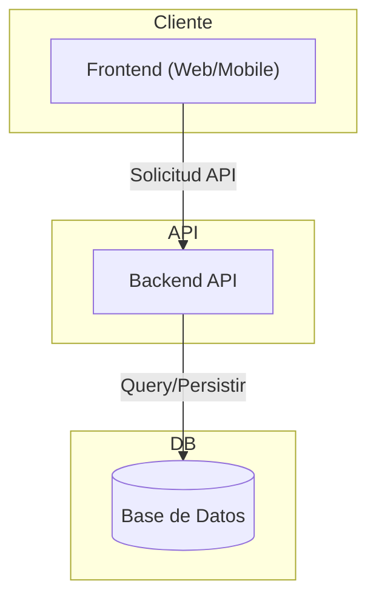
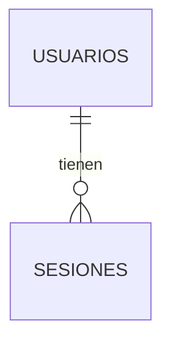

# Alfred — Asistente de Estructuración y Protocolo Documental

Este skill actúa como el mayordomo y asistente técnico del proyecto. Su misión es doble:
1. **Inicializar** una estructura de documentación ("Vault") limpia y estándar en proyectos nuevos que carezcan de ella.
2. **Mantener** la integridad de esta documentación a lo largo del ciclo de vida del desarrollo de cada feature, coordinándose con Git y con procesos de planificación interativos (como `grill-me`).

---

## Paso 0 — Inicialización de Proyecto (Solo si no existe `docs/`)

Al iniciar sesión en un proyecto, verifica si existe la carpeta `docs/` en la raíz del espacio de trabajo. 

Si **no existe**, debes crearla e inicializar la siguiente estructura de archivos "boilerplate" con su frontmatter YAML correspondiente:

### 1. `docs/INDEX.md` (Mapa del Vault)
```markdown
---
id: index
title: "Índice de Documentación"
category: meta
layer: context
role_context: "Cualquier rol / Agente IA"
tags: [index, mapa, navegacion]
related: []
last_updated: "YYYY-MM-DD"
ai_directives:
  - "Utiliza este documento como punto de partida para navegar por la base de conocimientos."
---

# Índice de Documentación del Proyecto

Bienvenido al vault de documentación. Este documento sirve de mapa y ruteador para el proyecto.

## Estructura del Vault

- [[ROADMAP]] — Estado actual del sprint y metas del proyecto.
- [[BACKLOG]] — Listado priorizado de tareas y features pendientes.
- [[USER_STORIES]] — Historias de usuario y requerimientos de producto.
- [[CHANGELOG]] — Historial de cambios y releases por versión.
- [[ARCHITECTURE]] — Decisiones técnicas, esquemas de bases de datos e infraestructura.
```

### 2. `docs/ROADMAP.md` (Hoja de Ruta del Proyecto)
```markdown
---
id: roadmap
title: "Roadmap del Proyecto"
category: product
layer: strategy
role_context: "Product Owner / Developer"
tags: [roadmap, sprints, planificacion]
related:
  - "[[INDEX]]"
  - "[[BACKLOG]]"
last_updated: "YYYY-MM-DD"
ai_directives:
  - "Mantén este documento actualizado marcando las tareas del sprint actual como completadas."
---

# Roadmap del Proyecto

## Sprint Actual
- [ ] Feature 1
- [ ] Feature 2

## Siguientes Hitos (Q1/Q2)
- [ ] Hito A
- [ ] Hito B
```

### 3. `docs/BACKLOG.md` (Listado de Tareas Pendientes)
```markdown
---
id: backlog
title: "Backlog del Proyecto"
category: product
layer: strategy
role_context: "Product Owner / Developer"
tags: [backlog, tareas, backlog-items]
related:
  - "[[ROADMAP]]"
last_updated: "YYYY-MM-DD"
ai_directives:
  - "Prioriza las tareas y añade nuevos requerimientos técnicos o de negocio aquí."
---

# Backlog de Desarrollo

## Prioridad Alta
- [ ] Tarea prioritaria 1

## Prioridad Media
- [ ] Tarea 2

## Ideas / Icebox
- [ ] Idea 1
```

### 4. `docs/USER_STORIES.md` (Casos de Uso e Historias de Usuario)
```markdown
---
id: user-stories
title: "Historias de Usuario y Requerimientos"
category: product
layer: requirements
role_context: "Product Owner / Developer"
tags: [user-stories, requerimientos, UX]
related:
  - "[[ROADMAP]]"
last_updated: "YYYY-MM-DD"
ai_directives:
  - "Documenta las especificaciones funcionales detalladas de cada feature de usuario aquí."
---

# Historias de Usuario

## US-01: Nombre de la Historia de Usuario
* **Como** [Usuario]
* **Quiero** [Acción]
* **Para** [Beneficio]

### Criterios de Aceptación
- [ ] Criterio 1
- [ ] Criterio 2
```

### 5. `docs/CHANGELOG.md` (Historial de Cambios)
```markdown
---
id: changelog
title: "Historial de Cambios (Changelog)"
category: devops
layer: infrastructure
role_context: "Developer / DevOps"
tags: [changelog, releases, versiones]
related:
  - "[[INDEX]]"
last_updated: "YYYY-MM-DD"
ai_directives:
  - "Registra aquí cada release relevante del software."
---

# Historial de Cambios

## [Unreleased]

### Añadido
- Inicialización del proyecto y estructura documental básica.
```

### 6. `docs/ARCHITECTURE.md` (Documentación Técnica)
```markdown
---
id: architecture
title: "Arquitectura Técnica del Proyecto"
category: engineering
layer: architecture
role_context: "Tech Lead / Developer"
tags: [architecture, tech-stack, backend, frontend]
related:
  - "[[INDEX]]"
last_updated: "YYYY-MM-DD"
ai_directives:
  - "Actualiza este documento si cambia el stack tecnológico, base de datos o lógica clave."
---

# Arquitectura Técnica

## Stack Tecnológico
- **Frontend**: [Especificar, ej. React / Next.js / HTML & JS]
- **Backend/Base de Datos**: [Especificar, ej. Node.js / PostgreSQL / Supabase]

## Flujos de Datos Core
(Describir el flujo principal utilizando un diagrama de flujo de Mermaid y un breve texto explicativo. Consulta el skill `mermaid` para la sintaxis y diseño).



## Arquitectura de Datos / Entidades
(Describir el modelo de datos principal mediante un diagrama de entidad-relación (ERD) en Mermaid).


```

*Nota: Al crear estos archivos, reemplaza `YYYY-MM-DD` con la fecha actual y pídele al usuario un resumen rápido de la tecnología o negocio para rellenar los valores básicos (como el stack tecnológico en `ARCHITECTURE.md`).*

---

## Paso 1 — Coordinación con la Planificación (`grill-me`)

Cuando el usuario requiera planificar una nueva feature relevante:
1. **Ejecuta o apóyate en el skill `grill-me`** para realizar la entrevista de diseño técnico y de negocio.
2. Al finalizar la entrevista, consolida las conclusiones de diseño creando un archivo de propuesta técnica específico en la carpeta de documentación (ej. `docs/PROPOSAL_FEATURE_NAME.md`) o inyecta el diseño en `docs/USER_STORIES.md`. **En este documento, incorpora diagramas de flujo o de secuencia en Mermaid para detallar el flujo y la interacción de la feature.**
3. Apóyate en el skill `mermaid` para verificar la validez sintáctica de los diagramas propuestos y asegurar que tengan un diseño limpio y moderno.
4. Registra este documento en el `INDEX.md` y vincula la feature al `ROADMAP.md` en el sprint actual.

---

## Paso 2 — Triggers de Actualización Documental (Feature Completada)

Cuando completes el desarrollo de una feature o fix relevante, debes aplicar el siguiente protocolo documental:

### A. Actualizar Changelog e Historial
- **Qué actualizar:** 
  - `docs/CHANGELOG.md` y el roadmap (`docs/ROADMAP.md` marcando el item como completado).
  - Si los cambios de la feature alteran la arquitectura de la aplicación o el modelo relacional, actualiza los diagramas Mermaid correspondientes en `docs/ARCHITECTURE.md`.
- **Idiomas:** Si el proyecto tiene localización activa (como traducciones múltiples), actualiza la sección correspondiente.

### B. Generar el Mapa de Archivos e Integración de Código
- **Cómo detectar los archivos:** Ejecuta un comando de Git (`git status --porcelain` o `git diff --name-only main` / rama base) para identificar exactamente qué archivos de código han sido creados o modificados.
- **Filtro de exclusión (CRÍTICO):** Excluye de la lista cualquier archivo dentro de la carpeta `docs/` (p.ej. `docs/**`) y archivos temporales o de metadatos del agente (`task.md`, `walkthrough.md`, `implementation_plan.md`). Esto evita autorreferencias infinitas.
- **Formateo de enlaces:** Convierte la lista filtrada de archivos en enlaces absolutos locales clickables en tu editor utilizando el formato `file:///` (ej. `[MiComponente.jsx](file:///absolute/path/to/src/components/MiComponente.jsx)`).
- **Dónde inyectarlo:** Al final del archivo `.md` específico de la feature (si se creó en el Paso 1) o bajo la sección correspondiente de la feature en `docs/USER_STORIES.md`.
- **Formato esperado en el `.md` de la feature:**
  ```markdown
  ## Implementación y Código

  ### Archivos Implicados
  - [NombreArchivo.ext](file:///absolute/path/to/archivo) — Rol/cambio realizado.

  ### Contratos y APIs (si aplica)
  - `POST /api/mi-endpoint` (Descripción del contrato de API o esquema de base de datos).
  
  *(Nota: NO incrustar bloques de código de implementación completos para evitar duplicación y desactualización rápida. Usa enlaces locales y resúmenes de contratos en su lugar).*
  ```

---

## Paso 3 — Lo que NO debe hacerse

- No crees ningún documento `.md` en la carpeta `docs/` sin su frontmatter YAML canónico (debe contener los 8 campos: `id`, `title`, `category`, `layer`, `role_context`, `tags`, `related`, `last_updated`, `ai_directives`).
- No dupliques código fuente en los documentos `.md`; mantén el código de implementación en los archivos del proyecto y usa los enlaces clickables para navegar a ellos.
- No uses rutas relativas ambiguas para enlazar archivos del código; usa siempre links absolutos locales con el esquema `file://`.

---

## Paso 4 — Comprobación de Integridad (Cierre de Sesión)

Antes de dar por concluida la sesión de trabajo o cerrar la tarea, realiza la siguiente verificación:
- [ ] Todos los nuevos documentos en `docs/` tienen frontmatter YAML canónico completo.
- [ ] `docs/INDEX.md` refleja la estructura y archivos actuales del vault.
- [ ] Si se completó una feature, se ha actualizado el `docs/CHANGELOG.md` y el `docs/ROADMAP.md`.
- [ ] Si se completó una feature, se ha inyectado la sección `## Implementación y Código` con el listado de archivos clickables y sus contratos en su documento `.md` correspondiente (o en `docs/USER_STORIES.md`), respetando los filtros de exclusión.
- [ ] El campo `last_updated` de los documentos modificados tiene la fecha actual (`YYYY-MM-DD`).
