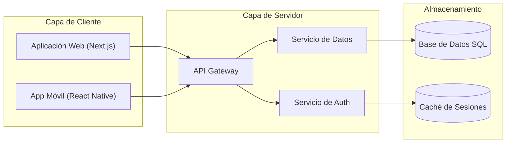
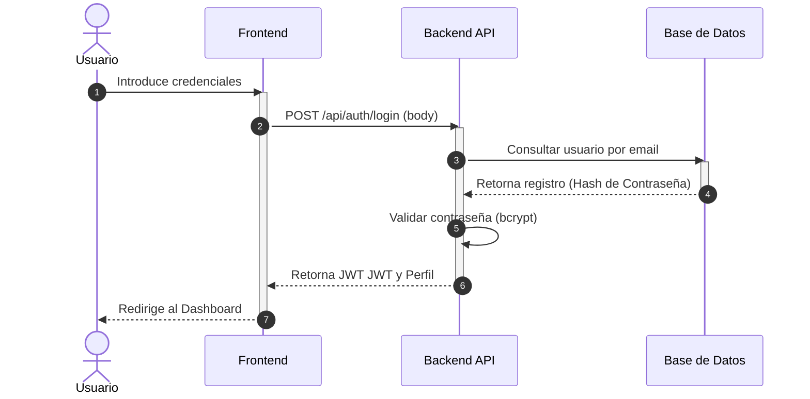
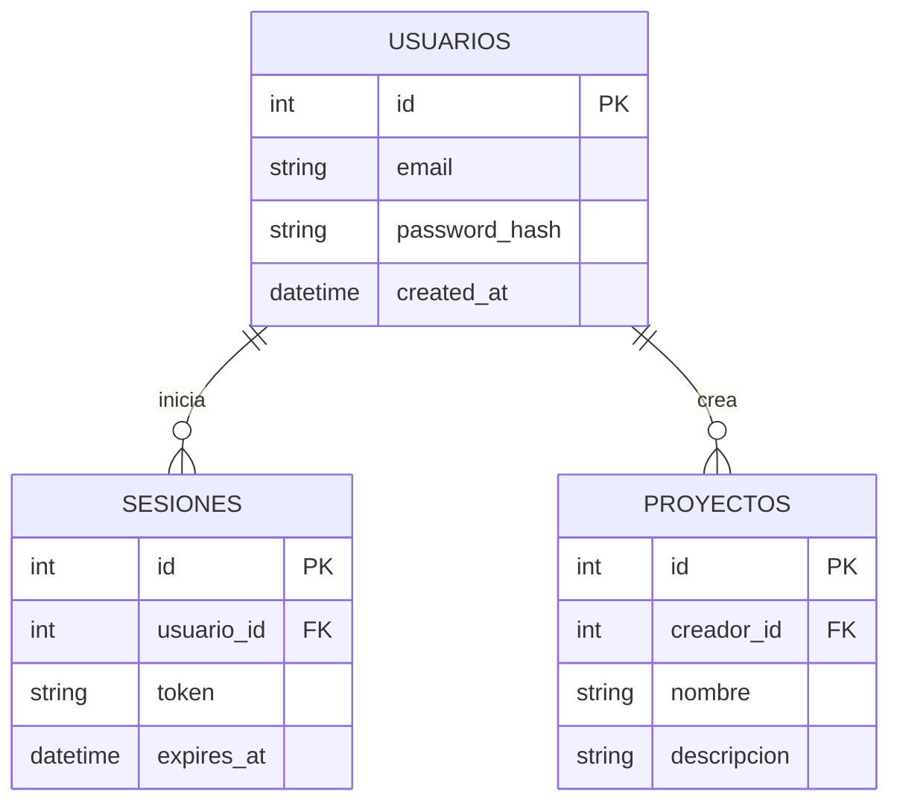

# Mermaid — Guía de Diagramación Técnica y Visual

Este skill proporciona las directivas y mejores prácticas necesarias para generar diagramas en formato Mermaid dentro del vault de documentación de cualquier proyecto. El objetivo es asegurar que los diagramas sean visualmente atractivos, autoexplicativos y sintácticamente válidos en cualquier renderizador Markdown.

---

## 1. Reglas Críticas para Evitar Errores de Renderizado (Sintaxis)

Mermaid es estricto con su sintaxis. Un solo carácter mal puesto puede romper la visualización completa del documento. Sigue estas reglas estrictas:

### A. Escape de Caracteres Especiales
Los caracteres especiales en las etiquetas de los nodos (como paréntesis `()`, corchetes `[]`, llaves `{}`, comillas `"`, dos puntos `:` o signos de puntuación) **siempre** deben ir envueltos en comillas dobles.
* **Incorrecto (Rompe el parseo):**
  ```mermaid
  A[Cliente (Web)] --> B{¿Tiene Token?}
  ```
* **Correcto:**
  ```mermaid
  A["Cliente (Web)"] --> B{"¿Tiene Token?"}
  ```

### B. IDs de Nodos Limpios
Usa IDs de nodo alfanuméricos simples y sin caracteres especiales. Define el texto visible por separado usando comillas.
* **Incorrecto:**
  ```mermaid
  auth-service(1) --> db_user_table
  ```
* **Correcto:**
  ```mermaid
  authService1["Auth Service (v1)"] --> dbUserTable["Tabla de Usuarios (DB)"]
  ```

### C. Evitar HTML Conflictivo
* No utilices etiquetas HTML complejas dentro de las etiquetas de texto de Mermaid.
* Para saltos de línea dentro de un nodo, utiliza `\n` dentro de una cadena entrecomillada en lugar de `<br>`.
  * **Ejemplo:** `A["Usuario Registrado\n(Activo)"]`

### D. Enlaces e Interacciones
* No añadas eventos de clic (`click`) ni enlaces interactivos complejos en diagramas estáticos dentro de la documentación Markdown para evitar comportamientos inesperados de renderizado.

---

## 2. Tipos de Diagramas Recomendados

### A. Flowcharts (Flujo de Datos o Procesos)
* Usa siempre la palabra clave `flowchart` en lugar de `graph`, ya que ofrece mejores opciones de renderizado y direccionamiento.
* Configura la orientación apropiada:
  * `TD` / `TB` (Top Down / Top-to-Bottom): Ideal para procesos secuenciales de arriba a abajo.
  * `LR` (Left to Right): Ideal para flujos de datos donde se quiere destacar el paso de un servicio a otro horizontalmente.
* Agrupa componentes con `subgraph` para dar orden visual (por ejemplo, separar el Frontend, el Backend y la Base de Datos).

#### Ejemplo de Flowchart:


### B. Sequence Diagrams (Interacciones Temporales / APIs)
* Ideal para modelar el orden temporal en que ocurren las peticiones HTTP, eventos o llamadas a funciones entre componentes.
* Utiliza `autonumber` al inicio del diagrama para indexar de manera clara cada paso.
* Utiliza bloques de activación (`activate` / `deactivate` o los atajos `+` / `-`) para mostrar cuándo un componente está procesando activamente.

#### Ejemplo de Sequence Diagram:


### C. Entity Relationship Diagrams (Diseño de Bases de Datos)
* Ideal para documentar esquemas de base de datos relacionales en `ARCHITECTURE.md`.
* Define los tipos de atributos y claves primarias/foráneas (`PK`, `FK`).
* Usa las notaciones de cardinalidad correctas:
  * `||--||` (Uno a uno exacto)
  * `||--o{` (Uno a cero o muchos)
  * `||--|{` (Uno a uno o muchos)

#### Ejemplo de ERD:


---

## 3. Guía de Estética y Limpieza Visual

* **Simplicidad:** Si un diagrama empieza a tener más de 15-20 nodos, divídelo en varios subdiagramas con focos específicos. Un diagrama gigante y enmarañado es inútil.
* **Títulos y Notas:** Usa la sintaxis de notas (`Note left of`, `Note over`) en los diagramas de secuencia para explicar reglas de negocio críticas directamente sobre el flujo.
* **Coherencia de Colores:** Intenta que los componentes similares compartan estilos o estén agrupados en el mismo `subgraph`. Evita colorear nodos de forma ad-hoc y estridente; confía en los colores armónicos predeterminados del tema del lector de Markdown.
